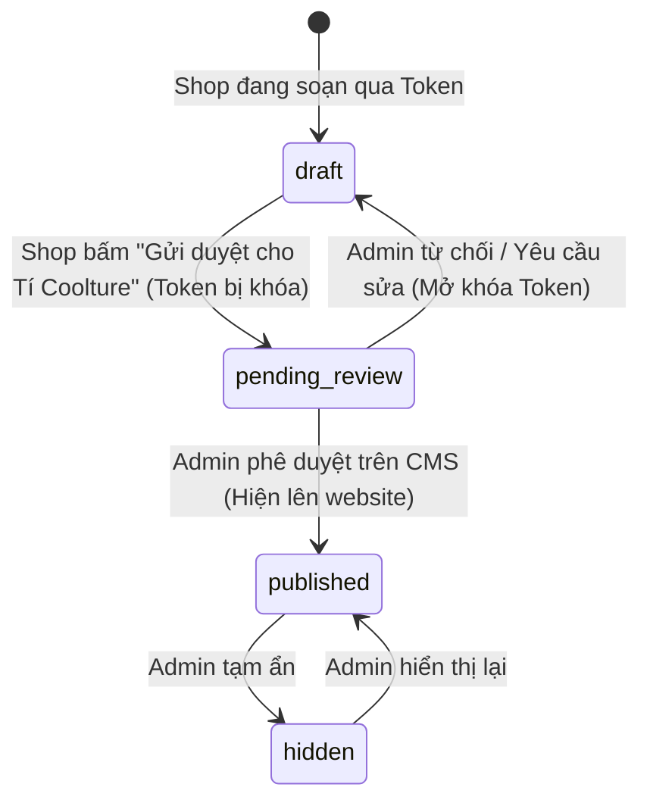

# TÍ COOLTURE — Backend Software Requirements Specification (Backend SRS)

**Tài liệu:** Yêu cầu kỹ thuật & Kiến trúc phân hệ Backend  
**Phiên bản:** 1.0  
**Ngày cập nhật:** 13/10/2026  
**Chủ sở hữu kỹ thuật & Giám sát:** Lộc  
**Đơn vị thực thi & Bảo trì:** AI Agents (Antigravity) dưới sự giám sát của Lộc  
**Kế thừa & Đối chiếu:** `docs/SRS.md` (v1.1), `BE plans.md`, và các phiên thảo luận kiến trúc phân hệ Partner Portal.

---

## 1. BỐI CẢNH DỰ ÁN & TRIẾT LÝ VẬN HÀNH

### 1.1 Bối cảnh đặc thù
* **Nhân sự:** 1 người giám sát (Lộc) + các LLM Agents thực thi và bảo trì trực tiếp mã nguồn.
* **Quy mô dữ liệu hình ảnh:** Không dừng lại ở vài chục ảnh mock, mà được thiết kế để mở rộng phục vụ **hàng nghìn hình ảnh chất lượng cao** từ hàng chục đến hàng trăm thương hiệu thủ công (artisan / local brands).
* **Mô hình kiến trúc Repository:** **Monorepo** (Frontend + Backend APIs + Database Migrations nằm chung 1 repo).
  * *Lý do:* Giữ Single Context cho AI Agents; khi Database schema thay đổi, agents tự động phát hiện và đồng bộ TypeScript types cho Frontend ngay lập tức, triệt tiêu rủi ro lệch contract giữa 2 repo tách rời.

### 1.2 Triết lý "Calm Infrastructure" (Hạ tầng bình yên)
Hạ tầng phải được thiết kế để hạn chế tối đa việc người vận hành phải thức dậy lúc nửa đêm xử lý sự cố:
1. **Serverless & Managed First:** Ưu tiên Supabase (PostgreSQL + Auth + RLS) và Cloudflare R2 (Lưu trữ ảnh S3-compatible).
2. **Zero-Egress Cost:** Tách toàn bộ việc lưu trữ và phân phối ảnh ra khỏi máy chủ ứng dụng. Dùng Cloudflare R2 để chi phí băng thông đọc/tải ảnh luôn là **0 VNĐ**, bất kể lượt truy cập tăng đột biến.
3. **Pháp lý tối giản (Tuân thủ Nghị định 13/2023/NĐ-CP):** Giảm thiểu tối đa việc thu thập dữ liệu cá nhân nhạy cảm, mật khẩu, và quy trình đăng ký tài khoản rườm rà.

---

## 2. PHÂN HỆ SHOP ONBOARDING PORTAL (CỔNG ĐĂNG SẢN PHẨM)

### 2.1 Bài toán nghiệp vụ & Vấn đề cần giải quyết
* Các thương hiệu thủ công, nghệ nhân cần không gian tự nhập câu chuyện thương hiệu, tải ảnh sản phẩm và mô tả.
* **Trở ngại thực tế:** Quy trình đăng ký tài khoản truyền thống (nhập email -> tạo mật khẩu -> xác thực email OTP/link) gây ma sát cực lớn, khiến đối tác nản lòng và bỏ cuộc. Đồng thời, việc lưu trữ mật khẩu kéo theo các nghĩa vụ bảo vệ dữ liệu cá nhân phức tạp.
* **Yêu cầu cốt lõi:**
  1. Đăng ký & truy cập không mật khẩu, không xác thực email.
  2. Tuyệt đối **không có link/nút truy cập công khai** trên trang chủ hay menu website. Link portal phải do đích thân team Tí Coolture gửi riêng cho từng shop.
  3. Cho phép chọn nhiều ảnh một lúc (`multiple files`) và **kéo thả (Drag & Drop) để sắp xếp thứ tự hiển thị**.
  4. Sau khi đăng xong, phải qua **quy trình Admin thẩm định (Review)**. Chỉ khi Admin duyệt thì sản phẩm và ảnh mới được chính thức xuất hiện trên trang web.

---

### 2.2 Đánh giá 5 giải pháp xác thực & Lựa chọn kiến trúc

| # | Giải pháp | Cơ chế xác thực | Mức độ tiện lợi cho Shop | Gánh nặng pháp lý (NĐ 13) | Độ an toàn & Kiểm soát |
|---|---|---|---|---|---|
| **1** | **Magic Onboarding Token** *(Được chọn)* | Link chứa Crypto Token do Admin sinh ra (gửi qua Zalo/Direct) | ⭐⭐⭐⭐⭐ (Bấm là vào) | Tối thiểu (0 lưu PII) | Rất cao (Có TTL, gắn chặt shop) |
| **2** | **Token + Passcode 6 số** | Link bí mật + Mã PIN 6 số gửi riêng tin nhắn thứ hai | ⭐⭐⭐⭐ (Nhập 6 số PIN) | Tối thiểu | Rất cao (Bảo vệ khi link bị chuyển tiếp) |
| **3** | **Zalo One-Click OAuth** | Đăng nhập 1-chạm bằng Zalo App thông qua số ĐT whitelist | ⭐⭐⭐⭐⭐ (Quen thuộc ở VN) | Trung bình (cần chính sách Zalo) | Tuyệt đối |
| **4** | **State-Machine Token Lock** *(Kết hợp)* | Token tự động khóa quyền sửa ngay khi bấm "Gửi duyệt" | ⭐⭐⭐⭐⭐ (Tránh sửa nhầm) | Tối thiểu | Tuyệt đối (Chống thay đổi sau submit) |
| **5** | **Passkey / WebAuthn** | Xác thực sinh trắc học (FaceID / Vân tay) trên điện thoại | ⭐⭐⭐ (Hơi lạ với nghệ nhân) | Tối thiểu | Tuyệt đối |

#### Quyết định kiến trúc chính thức:
Kết hợp **Giải pháp 1 (Magic Onboarding Token)** và **Giải pháp 4 (State-Machine Token Lock)**:
* Admin tạo link mời trong dashboard nội bộ.
* Hệ thống sinh ra 1 link duy nhất: `https://ticoolture.vn/portal/setup?token=tc_inv_8f9a2b...`
* Link chỉ được team gửi trực tiếp cho đại diện shop qua Zalo / Messenger.
* Shop truy cập, nhập thông tin, upload ảnh kéo thả, bấm **"Gửi bài cho Tí Coolture duyệt"**.
* Token lập tức chuyển sang trạng thái khóa (`locked_pending`), chuyển form về chế độ Read-only.

---

### 2.3 Cơ chế Bảo mật & Ẩn Portal hoàn toàn (Hidden Portal Constraints)

1. **Tuyệt đối ẩn danh trên Client:**
   * Không có bất kỳ liên kết, nút bấm, hay chuyển hướng nào từ trang chủ, header, footer, hay drawer của `ticoolture.vn`.
   * Thêm chỉ thị chống lập chỉ mục tìm kiếm:
     ```html
     <meta name="robots" content="noindex, nofollow" />
     ```
     vào tất cả các route thuộc `/portal/*`.
2. **Cơ chế kiểm soát Guard Route:**
   * Truy cập thẳng vào `https://ticoolture.vn/portal` mà không có `?token=...` hợp lệ sẽ lập tức bị **Redirect về Trang chủ** hoặc trả về lỗi **404 Not Found**.
   * Token được kiểm tra tính hợp lệ qua backend API (`/api/portal/verify-token`) trước khi giao diện soạn thảo được hiển thị:
     * Kiểm tra chữ ký & tính toàn vẹn (HMAC / UUIDv4 hash).
     * Kiểm tra thời hạn hiệu lực (`expires_at`, mặc định 14 ngày).
     * Kiểm tra trạng thái token (`active`, `locked_pending`, `used`, `revoked`).
3. **Thu hồi quyền tức thì (Revocation):**
   * Nếu phát hiện link bị lộ ra ngoài, Admin có thể ấn nút "Thu hồi Token" (Revoke) ngay trên dashboard, vô hiệu hóa truy cập ngay lập tức.

---

### 2.4 Tính năng Upload nhiều ảnh & Kéo thả sắp xếp (Drag & Drop Reordering)

#### Trải nghiệm người dùng (UX):
1. Shop bấm nút `[ Chọn nhiều ảnh ]` hoặc kéo hàng loạt file ảnh thả vào vùng dropzone.
2. Trình duyệt hiển thị danh sách ảnh dưới dạng lưới (Thumbnail Grid) kèm thanh tiến trình upload (Progress bar).
3. **Kéo thả sắp xếp (Reordering):**
   * Shop có thể click-and-drag để đổi vị trí thứ tự các ảnh trực quan trên màn hình (sử dụng HTML5 Drag & Drop hoặc thư viện nhẹ `@dnd-kit`).
   * Vị trí đầu tiên (Index 0) luôn hiển thị huy hiệu đặc biệt: **"Ảnh đại diện (Cover)"**.
   * Mỗi ảnh có nút xóa nhanh nếu chọn nhầm.

#### Cơ chế kỹ thuật Direct-to-R2 (Tránh nghẽn Server):
* **Không upload file trực tiếp qua Vercel Serverless Function** (tránh giới hạn payload 4.5MB và nghẽn RAM server).
* **Quy trình thực thi:**
  ```mermaid
  sequenceDiagram
    autonumber
    actor Shop as Shop Partner
    participant FE as Portal Frontend
    participant API as Vercel Serverless (/api/upload-ticket)
    participant R2 as Cloudflare R2 Storage
    participant DB as Supabase PostgreSQL

    Shop->>FE: Chọn 5 ảnh & bắt đầu upload
    FE->>API: Gửi danh sách tên file + kích thước kèm Token
    API->>API: Xác thực Token hợp lệ & quota ảnh
    API->>R2: Tạo Presigned PUT URLs (hạn 15 phút)
    API-->>FE: Trả về danh sách Presigned URLs
    loop Từng ảnh
      FE->>R2: Upload trực tiếp file binary lên R2 (PUT)
    end
    Shop->>FE: Kéo thả đổi vị trí ảnh trên lưới UI
    FE->>FE: Cập nhật lại mảng sort_order cục bộ
    Shop->>FE: Bấm "Gửi bài duyệt"
    FE->>API: Gửi payload sản phẩm kèm danh sách R2 Keys và sort_order
    API->>DB: Ghi vào products và product_images (status: pending_review)
    API->>DB: Đổi token sang locked_pending
    API-->>FE: Báo thành công, chuyển UI sang Read-Only
  ```

---

### 2.5 Quy trình Kiểm duyệt & Thông báo Quản trị (Review & Approval Flow)

#### Vòng đời trạng thái (State Machine):
Trường `publish_status` áp dụng cho cả `shops` và `products`:



1. **Giai đoạn `draft`:** Dữ liệu đang được shop chỉnh sửa, lưu nháp tự động (Auto-save) sau mỗi 30 giây.
2. **Giai đoạn `pending_review`:**
   * Token chuyển sang `locked_pending`. Shop không thể tự ý sửa đổi nội dung hay hoán đổi ảnh trong khi đang chờ duyệt.
   * Hệ thống kích hoạt **Webhook thông báo Admin** (gửi tin nhắn tự động về Telegram Bot của Lộc hoặc Zalo Webhook):
     > 🔔 **Có sản phẩm mới chờ duyệt!**  
     > • **Shop:** Gốm Mộc Chân  
     > • **Sản phẩm:** Bình hoa gốm vuốt tay Men Tro  
     > • **Số lượng ảnh:** 6 ảnh  
     > 🔗 *[Bấm vào đây để xem trước và duyệt]*
3. **Giai đoạn `published`:**
   * Admin bấm **"Duyệt sản phẩm"** trên trang quản trị.
   * Bản ghi chuyển sang trạng thái `published`.
4. **Nguyên tắc cô lập hiển thị công khai (Isolate Data):**
   * Mọi câu lệnh truy vấn dữ liệu phía Client trên trang chủ `ticoolture.vn` (qua Supabase RLS hoặc API route) **bắt buộc phải có điều kiện**:
     ```sql
     WHERE publish_status = 'published'
     ```
   * Dữ liệu đang ở `draft` hoặc `pending_review` không bao giờ xuất hiện trên trang chủ, danh mục, hay kết quả tìm kiếm của khách vãng lai.

---

## 3. THIẾT KẾ DATABASE SCHEMA CHO PHÂN HỆ PORTAL

Bổ sung bảng quản lý Token và nâng cấp bảng ảnh sản phẩm vào hệ thống migrations của Supabase:

### 3.1 Bảng `portal_invites` (Quản lý Link mời)
```sql
CREATE TYPE portal_invite_status AS ENUM ('active', 'locked_pending', 'completed', 'revoked');

CREATE TABLE portal_invites (
  id              uuid PRIMARY KEY DEFAULT uuid_generate_v4(),
  shop_id         uuid NOT NULL REFERENCES shops(id) ON DELETE CASCADE,
  token_hash      text UNIQUE NOT NULL,      -- Hash của secret token
  passcode        varchar(6),                 -- Tùy chọn: PIN 6 số nếu kích hoạt lớp bảo vệ 2
  status          portal_invite_status NOT NULL DEFAULT 'active',
  created_by      uuid REFERENCES staff_members(user_id),
  expires_at      timestamptz NOT NULL,       -- Hết hạn (mặc định now() + interval '14 days')
  submitted_at    timestamptz,                -- Thời điểm shop bấm gửi duyệt
  metadata        jsonb DEFAULT '{}'::jsonb,  -- Thông tin liên hệ, ghi chú nội bộ
  created_at      timestamptz NOT NULL DEFAULT now(),
  updated_at      timestamptz NOT NULL DEFAULT now()
);

CREATE INDEX idx_portal_invites_token ON portal_invites(token_hash);
CREATE INDEX idx_portal_invites_shop ON portal_invites(shop_id);
```

### 3.2 Bảng `product_images` (Lưu trữ ảnh & Thứ tự sắp xếp)
```sql
CREATE TABLE product_images (
  id              uuid PRIMARY KEY DEFAULT uuid_generate_v4(),
  product_id      uuid NOT NULL REFERENCES products(id) ON DELETE CASCADE,
  r2_key          text NOT NULL,              -- Đường dẫn file trên Cloudflare R2
  sort_order      int NOT NULL DEFAULT 0,     -- Thứ tự kéo thả (0 là cover)
  is_cover        boolean NOT NULL DEFAULT false,
  width           int,
  height          int,
  alt_text        text,
  created_at      timestamptz NOT NULL DEFAULT now()
);

CREATE INDEX idx_product_images_product ON product_images(product_id, sort_order);
```

---

## 4. MA TRẬN API ENDPOINTS CHO PHÂN HỆ PORTAL

Tất cả các API này được xây dựng dưới dạng **Vercel Serverless Functions** (`/api/portal/*`), không lộ anon key trực tiếp cho các thao tác nhạy cảm:

| Endpoint | Phương thức | Quyền hạn | Chức năng |
|---|---|---|---|
| `/api/admin/portal/create-invite` | `POST` | Admin/Staff | Tạo link mời mới cho 1 shop, trả về full invitation URL để gửi qua Zalo |
| `/api/admin/portal/revoke-invite` | `POST` | Admin | Thu hồi link mời ngay lập tức |
| `/api/portal/verify-token` | `POST` | Public (kèm Token) | Xác minh token hợp lệ, trả về thông tin shop và dữ liệu nháp hiện tại |
| `/api/portal/upload-ticket` | `POST` | Public (kèm Token) | Xin danh sách Presigned PUT URLs từ Cloudflare R2 để upload nhiều ảnh |
| `/api/portal/save-draft` | `POST` | Public (kèm Token) | Lưu nháp thông tin và thứ tự ảnh của sản phẩm |
| `/api/portal/submit-review` | `POST` | Public (kèm Token) | Chốt gửi duyệt, khóa token (`locked_pending`), bắn Telegram notification |
| `/api/admin/reviews/action` | `POST` | Admin | Duyệt (`published`) hoặc Từ chối (`rejected` kèm lý do) |

---

## 5. KẾ HOẠCH DỰ PHÒNG & SỰ CỐ CHO 1 HUMAN SUPERVISOR

Khi vận hành thực tế chỉ có 1 người giám sát cùng AI Agents, các tình huống sự cố sau phải có kịch bản xử lý định sẵn (Runbook):

| Tình huống sự cố | Kịch bản phản ứng của Hệ thống | Hành động xử lý của Người / Agent |
|---|---|---|
| **Shop gửi ảnh quá nặng (> 10MB/ảnh)** | Frontend dùng canvas nén sơ bộ (client-side compression) trước khi PUT lên R2; chặn file > 15MB tại presigned ticket. | Agent kiểm tra code client compressor; không cần can thiệp server. |
| **Link mời vô tình bị lộ ra ngoài** | Token chỉ can thiệp được đúng dữ liệu của 1 shop đó; không thể xem hay sửa dữ liệu của shop khác (Row-Level Security & Scoped API). | Admin bấm 1 nút **"Thu hồi link"** trên dashboard. Hệ thống đổi trạng thái token sang `revoked`. |
| **Đứt kết nối mạng giữa lúc upload ảnh** | Frontend upload từng ảnh độc lập (concurrency = 3). Ảnh nào lỗi có nút **"Thử lại"** ngay cạnh thumbnail. | Shop bấm thử lại cho ảnh bị lỗi mà không phải upload lại từ đầu. |
| **Supabase hoặc R2 gặp sự cố kết nối** | API serverless bắt lỗi (try/catch), trả thông báo thân thiện: *"Hệ thống đang bảo trì, vui lòng lưu giữ ảnh và thử lại sau ít phút"*. | Webhook bắn cảnh báo về Telegram của admin kèm mã lỗi chi tiết. |

---

## 6. LỘ TRÌNH THỰC THI (ACTION ROADMAP)

* **Bước 1 (Database Migration):**
  * Chạy file migration tạo bảng `portal_invites` và thiết lập quan hệ với `shops`, `products`, `product_images`.
* **Bước 2 (Cloudflare R2 Direct Upload Integration):**
  * Cài đặt AWS S3 SDK (tương thích R2) trên Vercel Serverless Functions để phát sinh Presigned PUT URLs.
* **Bước 3 (Backend API Layer):**
  * Viết các serverless endpoints: tạo invite, verify token, xin ticket upload, submit review, và webhook thông báo Telegram.
* **Bước 4 (Frontend Partner Portal UI):**
  * Dựng route bí mật `/portal` (bảo vệ bằng token query).
  * Xây dựng giao diện tải nhiều ảnh, lưới kéo thả sắp xếp thứ tự (Drag & Drop), đánh dấu ảnh cover.
* **Bước 5 (Admin Review Workflow):**
  * Hoàn thiện màn hình duyệt bài trên trang quản trị, cho phép Admin xem trước (preview) giao diện sản phẩm y hệt như trên trang web thật trước khi ấn nút Xuất bản.
