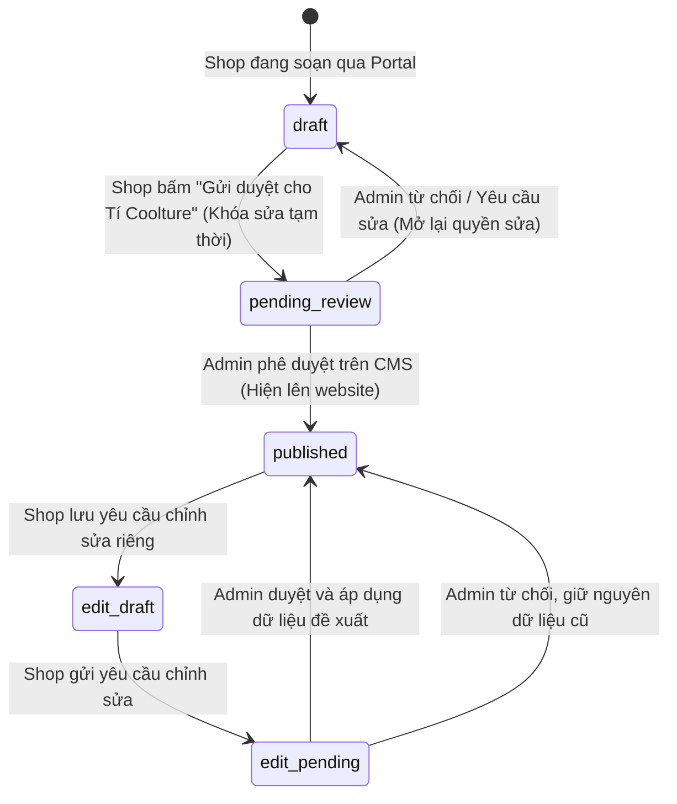

# TÍ COOLTURE — Backend Software Requirements Specification (Backend SRS)

**Tài liệu:** Yêu cầu kỹ thuật & Kiến trúc phân hệ Backend  
**Phiên bản:** 1.0  
**Ngày cập nhật:** 13/10/2026  
**Chủ sở hữu kỹ thuật & Giám sát:** Lộc  
**Đơn vị thực thi & Bảo trì:** AI Agents (Antigravity) dưới sự giám sát của Lộc  
**Kế thừa & Đối chiếu:** `docs/SRS.md` (v1.1), `BE plans.md`, và các phiên thảo luận kiến trúc phân hệ Partner Portal.

---

## 1. BỐI CẢNH DỰ ÁN & TRIẾT LÝ VẬN HÀNH

### 1.1 Bối cảnh đặc thù
* **Nhân sự:** 1 người giám sát (Lộc) + các LLM Agents thực thi và bảo trì trực tiếp mã nguồn.
* **Quy mô dữ liệu hình ảnh:** Không dừng lại ở vài chục ảnh mock, mà được thiết kế để mở rộng phục vụ **hàng nghìn hình ảnh chất lượng cao** từ hàng chục đến hàng trăm thương hiệu thủ công (artisan / local brands).
* **Mô hình kiến trúc Repository:** **Monorepo** (Frontend + Backend APIs + Database Migrations nằm chung 1 repo).
  * *Lý do:* Giữ Single Context cho AI Agents; khi Database schema thay đổi, agents tự động phát hiện và đồng bộ TypeScript types cho Frontend ngay lập tức, triệt tiêu rủi ro lệch contract giữa 2 repo tách rời.

### 1.2 Triết lý "Calm Infrastructure" (Hạ tầng bình yên)
Hạ tầng phải được thiết kế để hạn chế tối đa việc người vận hành phải thức dậy lúc nửa đêm xử lý sự cố:
1. **Serverless & Managed First:** Ưu tiên Supabase (PostgreSQL + Auth + RLS) và Cloudflare R2 (Lưu trữ ảnh S3-compatible).
2. **Zero-Egress Cost:** Tách toàn bộ việc lưu trữ và phân phối ảnh ra khỏi máy chủ ứng dụng. Dùng Cloudflare R2 để chi phí băng thông đọc/tải ảnh luôn là **0 VNĐ**, bất kể lượt truy cập tăng đột biến.
3. **Pháp lý tối giản (Tuân thủ Nghị định 13/2023/NĐ-CP):** Giảm thiểu tối đa việc thu thập dữ liệu cá nhân nhạy cảm, mật khẩu, và quy trình đăng ký tài khoản rườm rà.

### 1.3 Rationale Kiến trúc: Serverless vs Dedicated VPS & Upstash Redis Cache

#### 1. Tại sao chọn Serverless thay vì thuê VPS riêng?
* **Không tốn chi phí bảo trì hệ điều hành (Zero Ops):** Một VPS truyền thống đòi hỏi cấu hình Linux, SSH hardening, tường lửa (ufw), SSL auto-renewal (Certbot), reverse proxy (Nginx/Caddy), công cụ giữ tiến trình (PM2/Docker), và cập nhật vá lỗi bảo mật định kỳ. Với đội ngũ 1 người giám sát, đây là gánh nặng không cần thiết.
* **Chi phí nhàn rỗi là 0 VNĐ:** Serverless (Vercel + Supabase + Cloudflare R2) tính phí theo mức sử dụng thực tế (pay-as-you-go / free tier). Khi chưa có traffic, chi phí duy trì hàng tháng là 0 đồng, thay vì phải trả tiền thuê máy chủ VPS cố định.
* **Tự động co giãn (Auto-elasticity):** Khi một bài viết hoặc sản phẩm viral, serverless tự động mở rộng instance phục vụ hàng chục nghìn lượt truy cập đồng thời mà không bao giờ bị nghẽn RAM hay sập máy chủ.
* **Hạn chế rủi ro "báo động lúc 2 giờ sáng":** Không lo kẹt ổ đĩa, rò rỉ bộ nhớ (memory leaks) làm treo tiến trình Node.js trên VPS.

#### 2. Tại sao chọn Upstash Redis (REST over HTTP) thay vì Redis TCP truyền thống?
* **Khắc phục điểm nghẽn Connection Pool:** Trong môi trường Vercel Serverless Functions, mỗi request có thể sinh ra một hàm độc lập (stateless ephemeral containers). Kết nối Redis truyền thống dùng socket TCP (`ioredis`) sẽ liên tục mở mới kết nối, dễ dẫn tới lỗi `Max client connections reached` làm sập cụm Redis.
* **Upstash Redis chạy qua HTTP REST API (`@upstash/redis`):** Không duy trì kết nối TCP socket thường trực, tối ưu hoàn hảo cho kiến trúc serverless không trạng thái.
* **Free tier hào phóng:** 10.000 requests/ngày, hoàn toàn miễn phí, tích hợp sẵn tính năng tự xóa theo thời gian (TTL).
* **Chiến lược Caching & Graceful Fallback:**
  * Endpoint `/api/search` lưu cache kết quả tìm kiếm với TTL 180 giây (3 phút).
  * Mã nguồn được thiết kế tự thích ứng (Graceful Fallback): Nếu môi trường chưa cấu hình biến môi trường Redis, hệ thống tự động bypass cache và truy vấn trực tiếp vào Supabase RPC mà không gây lỗi ứng dụng (zero-downtime).

---

## 2. PHÂN HỆ SHOP ONBOARDING PORTAL (CỔNG ĐĂNG SẢN PHẨM)

### 2.1 Bài toán nghiệp vụ & Vấn đề cần giải quyết
* Các thương hiệu thủ công, nghệ nhân cần không gian tự nhập câu chuyện thương hiệu, tải ảnh sản phẩm và mô tả.
* **Trở ngại thực tế:** Quy trình đăng ký tài khoản truyền thống (nhập email -> tạo mật khẩu -> xác thực email OTP/link) gây ma sát cực lớn, khiến đối tác nản lòng và bỏ cuộc. Đồng thời, việc lưu trữ mật khẩu kéo theo các nghĩa vụ bảo vệ dữ liệu cá nhân phức tạp.
* **Yêu cầu cốt lõi:**
  1. Đăng ký & truy cập không mật khẩu, không xác thực email.
### 2.1 Bài toán nghiệp vụ & Vấn đề cần giải quyết
* Các thương hiệu thủ công, nghệ nhân cần không gian tự nhập câu chuyện thương hiệu, tải ảnh sản phẩm và mô tả.
* **Trở ngại thực tế:** Quy trình đăng ký tài khoản truyền thống (nhập email -> tạo mật khẩu -> xác thực email OTP/link) gây ma sát cực lớn, khiến đối tác nản lòng và bỏ cuộc. Đồng thời, việc lưu trữ mật khẩu kéo theo các nghĩa vụ bảo vệ dữ liệu cá nhân phức tạp (Nghị định 13/2023/NĐ-CP).
* **Yêu cầu cốt lõi:**
  1. **Đăng nhập 1-chạm bằng Google OAuth:** Tận dụng tài khoản Google/Gmail mà mọi chủ shop đều có sẵn trên điện thoại/máy tính. Không mật khẩu, không xác thực email thủ công, không token rườm rà.
  2. **Tái sử dụng hạ tầng cho tương lai:** Cơ sở hạ tầng Google OAuth (Supabase Auth) được thiết kế để sau này phục vụ luôn tính năng đăng nhập/tạo tài khoản của người dùng cuối (khách mua hàng đồng bộ wishlist, đánh giá...).
  3. Tuyệt đối **không có link/nút truy cập công khai** trên trang chủ hay menu website. Link portal phải do đích thân team Tí Coolture gửi riêng cho từng shop.
  4. Cho phép chọn nhiều ảnh một lúc (`multiple files`) và **kéo thả (Drag & Drop) để sắp xếp thứ tự hiển thị**.
  5. Sau khi đăng xong, phải qua **quy trình Admin thẩm định (Review)**. Chỉ khi Admin duyệt thì sản phẩm và ảnh mới được chính thức xuất hiện trên trang web.

---

### 2.2 Kiến trúc Xác thực Google OAuth & Phân quyền Shop

#### Quyết định kiến trúc chính thức: **Google OAuth (Supabase Auth Provider) + Whitelist / Invitation Association**
Thay vì yêu cầu shop lưu giữ những chuỗi token bí mật dài dòng dễ thất lạc, hệ thống sử dụng **Google OAuth**:

```
┌─────────────────────────────────────────────────────────────────────────────┐
│ 1. ADMIN THIẾT LẬP:                                                         │
│    Admin tạo Shop & gán email Google của đối tác (bảng shop_invitations)    │
│    Admin gửi link bí mật: https://ticoolture.vn/portal                      │
└──────────────────────────────────────┬──────────────────────────────────────┘
                                       ▼
┌─────────────────────────────────────────────────────────────────────────────┐
│ 2. ĐỐI TÁC TRUY CẬP & ĐĂNG NHẬP 1-CHẠM:                                     │
│    Shop mở link riêng -> Bấm "Tiếp tục với Google"                          │
│    Supabase Auth xử lý OAuth, xác nhận email đã định danh từ Google        │
└──────────────────────────────────────┬──────────────────────────────────────┘
                                       ▼
┌─────────────────────────────────────────────────────────────────────────────┐
│ 3. XÁC THỰC QUYỀN TRUY CẬP (AUTHORIZATION GUARD):                            │
│    - Nếu email khớp với shop_invitations: Tự động liên kết vào shop_members │
│      và mở khóa trang quản lý xưởng tương ứng.                              │
│    - Nếu email KHÔNG thuộc bất kỳ shop nào: Trả về lỗi 403 Forbidden        │
│      "Email này chưa được cấp quyền quản lý xưởng trên Tí Coolture".        │
└─────────────────────────────────────────────────────────────────────────────┘
```

#### Lợi ích vượt trội:
1. **Trải nghiệm đỉnh cao (Zero Friction):** Chủ shop chỉ cần bấm 1 chạm trên điện thoại hoặc trình duyệt để đăng nhập bằng tài khoản Google có sẵn.
2. **Tuân thủ pháp lý (Nghị định 13/2023/NĐ-CP):** Hệ thống Tí Coolture hoàn toàn không lưu trữ mật khẩu (hashed password), không lưu trữ thông tin nhạy cảm. Quản lý danh tính và bảo mật 2 lớp (2FA) do Google đảm nhiệm.
3. **Nền tảng mở rộng (Future-proof):** Cùng 1 hệ thống Supabase Google Auth, sau này chỉ cần bật thêm cờ người dùng (User Role) là khách hàng thông thường có thể đăng nhập để lưu Wishlist lên Cloud.

---

### 2.3 Cơ chế Bảo mật & Ẩn Portal hoàn toàn (Hidden Portal Constraints)

1. **Tuyệt đối ẩn danh trên Client:**
   * Không có bất kỳ liên kết, nút bấm, hay chuyển hướng nào từ trang chủ, header, footer, hay drawer của `ticoolture.vn`.
   * Toàn bộ các route `/portal/*` đều có thẻ:
     ```html
     <meta name="robots" content="noindex, nofollow" />
     ```
2. **Cơ chế kiểm soát Guard Route:**
   * URL vào portal (ví dụ: `https://ticoolture.vn/portal`) chỉ do team gửi qua Zalo / Messenger cho đối tác.
   * Người dùng truy cập phải đăng nhập Google.
   * Sau khi đăng nhập, API `/api/portal/me` kiểm tra email người dùng trong cơ sở dữ liệu:
     * Nếu hợp lệ: Cấp quyền truy cập Dashboard xưởng.
     * Nếu không hợp lệ: Hiển thị màn hình từ chối kèm nút đăng xuất hoặc liên hệ Admin.
3. **Thu hồi quyền tức thì (Revocation):**
   * Nếu ngừng hợp tác với shop, Admin chỉ cần hủy quyền trong bảng `shop_members` / `shop_invitations`. Shop sẽ bị chặn ngay trong phiên tiếp theo.

---

### 2.4 Tính năng Upload nhiều ảnh & Kéo thả sắp xếp (Drag & Drop Reordering)

#### Trải nghiệm người dùng (UX):
1. Shop bấm nút `[ Chọn nhiều ảnh ]` hoặc kéo hàng loạt file ảnh thả vào vùng dropzone.
2. Trình duyệt hiển thị danh sách ảnh dưới dạng lưới (Thumbnail Grid) kèm thanh tiến trình upload (Progress bar).
3. **Kéo thả sắp xếp (Reordering):**
   * Shop có thể click-and-drag để đổi vị trí thứ tự các ảnh trực quan trên màn hình (sử dụng HTML5 Drag & Drop hoặc thư viện nhẹ `@dnd-kit`).
   * Vị trí đầu tiên (Index 0) luôn hiển thị huy hiệu đặc biệt: **"Ảnh đại diện (Cover)"**.
   * Mỗi ảnh có nút xóa nhanh nếu chọn nhầm.

#### Cơ chế kỹ thuật Direct-to-R2 (Tránh nghẽn Server):
* **Không upload file trực tiếp qua Vercel Serverless Function** (tránh giới hạn payload 4.5MB và nghẽn RAM server).
* **Quy trình thực thi:**
  ```mermaid
  sequenceDiagram
    autonumber
    actor Shop as Shop Partner (Google Authenticated)
    participant FE as Portal Frontend
    participant API as Vercel Serverless (/api/portal/upload-ticket)
    participant R2 as Cloudflare R2 Storage
    participant DB as Supabase PostgreSQL

    Shop->>FE: Chọn 5 ảnh & bắt đầu upload
    FE->>API: Gửi danh sách tên file + kích thước (Header: Bearer JWT)
    API->>API: Xác thực Google JWT & quyền sở hữu Shop
    API->>R2: Tạo Presigned PUT URLs (hạn 15 phút)
    API-->>FE: Trả về danh sách Presigned URLs & R2 Keys
    loop Từng ảnh
      FE->>R2: Upload trực tiếp file binary lên R2 (PUT)
    end
    Shop->>FE: Kéo thả đổi vị trí ảnh trên lưới UI
    FE->>FE: Cập nhật lại mảng sort_order cục bộ
    Shop->>FE: Lưu sản phẩm rồi bấm "Gửi bài duyệt"
    FE->>API: Gửi mã sản phẩm đã lưu
    API->>DB: Đổi sản phẩm mới sang pending_review
    API->>API: Gửi Webhook thông báo Telegram cho Admin
    API-->>FE: Báo thành công, chuyển UI sang trạng thái Đang Chờ Duyệt
  ```

---

### 2.5 Quy trình Kiểm duyệt & Thông báo Quản trị (Review & Approval Flow)

#### Vòng đời trạng thái (State Machine):
Trường `publish_status` áp dụng cho cả `shops` và `products`. Trạng thái `hidden` của shop điều khiển trạng thái xuất bản của shop; việc ẩn sản phẩm được quản lý riêng bằng hai cờ `products.product_hidden` và `products.shop_hidden`:



Admin ẩn/hiện shop sẽ đồng thời đặt `shop_hidden` cho sản phẩm thuộc shop. Admin ẩn/hiện riêng sản phẩm chỉ thay đổi `product_hidden`; thao tác này không ghi đè trạng thái ẩn của shop.

1. **Giai đoạn `draft`:** Dữ liệu đang được shop chỉnh sửa, lưu nháp tự động (Auto-save) sau mỗi 30 giây.
2. **Giai đoạn `pending_review`:**
   * Trạng thái sản phẩm chuyển sang `pending_review`. Shop ở chế độ Xem (Read-only) trong khi chờ duyệt.
   * Hệ thống kích hoạt **Webhook thông báo Admin** (gửi tin nhắn tự động về Telegram Bot của Lộc hoặc Zalo Webhook):
     > 🔔 **Có sản phẩm mới chờ duyệt!**  
     > • **Shop:** Gốm Mộc Chân (gommocchan@gmail.com)  
     > • **Sản phẩm:** Bình hoa gốm vuốt tay Men Tro  
     > • **Số lượng ảnh:** 6 ảnh  
     > 🔗 *[Bấm vào đây để xem trước và duyệt]*
3. **Giai đoạn `published`:**
   * Admin bấm **"Duyệt sản phẩm"** trên trang quản trị.
   * Bản ghi chuyển sang trạng thái `published` và hiển thị ra catalogue công khai.
4. **Yêu cầu chỉnh sửa sản phẩm đã xuất bản:**
   * Shop lưu dữ liệu đề xuất và ảnh vào `product_edit_requests`; sản phẩm công khai không đổi.
   * Khi shop gửi duyệt, yêu cầu xuất hiện ở tab riêng trong Admin. Admin có thể xem preview, duyệt hoặc từ chối.
   * Duyệt sẽ cập nhật sản phẩm và ảnh trong cùng transaction; từ chối chỉ đổi trạng thái yêu cầu.
5. **Nguyên tắc cô lập hiển thị công khai (Isolate Data):**
   * Sản phẩm chỉ được công khai và có thể tìm kiếm khi cả sản phẩm và shop đã xuất bản, đồng thời cả hai cờ ẩn đều `false`:
     ```sql
     WHERE products.status = 'published'
       AND shops.status = 'published'
       AND products.product_hidden = false
       AND products.shop_hidden = false
     ```
   * Ẩn shop không đổi `product_hidden`; hiện lại shop không tự bật lại sản phẩm đã bị ẩn độc lập.
   * Dữ liệu đang ở `draft` hoặc `pending_review` không bao giờ xuất hiện trên trang chủ, danh mục, hay kết quả tìm kiếm của khách vãng lai. Dữ liệu đề xuất trong `product_edit_requests` cũng không được truy vấn công khai.

---

## 3. THIẾT KẾ DATABASE SCHEMA CHO PHÂN HỆ PORTAL (GOOGLE OAUTH)

Bổ sung bảng quản lý lời mời Google Email và hoàn thiện liên kết với bảng `shop_members` và `product_images`:

### 3.1 Bảng `shop_invitations` (Quản lý lời mời đối tác qua Google Email)
```sql
CREATE TYPE invite_status AS ENUM ('pending', 'accepted', 'revoked');

CREATE TABLE shop_invitations (
  id              uuid PRIMARY KEY DEFAULT uuid_generate_v4(),
  shop_id         uuid NOT NULL REFERENCES shops(id) ON DELETE CASCADE,
  invited_email   text NOT NULL,              -- Email Google của đại diện xưởng/shop
  shop_role       shop_role NOT NULL DEFAULT 'owner',
  status          invite_status NOT NULL DEFAULT 'pending',
  created_by      uuid REFERENCES staff_members(user_id),
  expires_at      timestamptz NOT NULL DEFAULT (now() + interval '30 days'),
  accepted_at     timestamptz,
  created_at      timestamptz NOT NULL DEFAULT now(),
  updated_at      timestamptz NOT NULL DEFAULT now(),
  UNIQUE (shop_id, invited_email)
);

CREATE INDEX idx_shop_invitations_email ON shop_invitations (invited_email);
CREATE INDEX idx_shop_invitations_shop  ON shop_invitations (shop_id);
```

> **Cơ chế Auto-Linking:** Khi shop owner đăng nhập Google OAuth lần đầu, nếu `auth.users.email` khớp với một bản ghi `shop_invitations` có `status = 'pending'`, hệ thống sẽ tự động chèn một bản ghi vào `shop_members (user_id, shop_id, shop_role)` và chuyển `status` sang `accepted`.

### 3.2 Bảng `product_images` (Lưu trữ ảnh & Thứ tự sắp xếp)
```sql
CREATE TABLE product_images (
  id              uuid PRIMARY KEY DEFAULT uuid_generate_v4(),
  product_id      uuid NOT NULL REFERENCES products(id) ON DELETE CASCADE,
  url             text NOT NULL,              -- Đường dẫn key trên Cloudflare R2
  is_cover        boolean NOT NULL DEFAULT false,
  sort_order      int NOT NULL DEFAULT 0,     -- Thứ tự kéo thả (0 là cover)
  width           int,
  height          int,
  alt_vi          text,
  alt_en          text
);

CREATE INDEX idx_product_images_product ON product_images(product_id, sort_order);
```

---

## 4. MA TRẬN API ENDPOINTS CHO PHÂN HỆ PORTAL (GOOGLE OAUTH)

Tất cả các API này được xây dựng dưới dạng **Vercel Serverless Functions** (`/api/portal/*`), xác thực phiên làm việc thông qua Supabase Google OAuth Session JWT (`Authorization: Bearer <access_token>`):

| Endpoint | Phương thức | Quyền hạn | Chức năng |
|---|---|---|---|
| `/api/portal/me` | `GET` | Google Authenticated | Xác thực Google session, tự động liên kết lời mời theo email, trả về thông tin shop và vai trò |
| `/api/portal/upload-ticket` | `POST` | Google Authenticated | Xác thực quyền của shop, cấp danh sách Presigned PUT URLs từ Cloudflare R2 |
| `/api/portal/save-draft` | `POST` | Google Authenticated | Lưu nháp sản phẩm; với sản phẩm đã xuất bản, lưu đề xuất riêng, không đổi dữ liệu công khai |
| `/api/portal/submit-review` | `POST` | Google Authenticated | Chốt gửi duyệt sản phẩm mới hoặc yêu cầu chỉnh sửa, kích hoạt Telegram Bot báo Admin |
| `/api/admin/portal/invite` | `POST` | Admin/Staff | Thêm lời mời quản lý xưởng gửi tới email Google của shop đối tác |
| `/api/admin/reviews/action` | `POST` | Admin/Staff | Phê duyệt (`published`) hoặc Từ chối (`rejected` kèm lý do) |

---

## 5. KẾ HOẠCH DỰ PHÒNG & SỰ CỐ CHO 1 HUMAN SUPERVISOR

Khi vận hành thực tế chỉ có 1 người giám sát cùng AI Agents, các tình huống sự cố sau phải có kịch bản xử lý định sẵn (Runbook):

| Tình huống sự cố | Kịch bản phản ứng của Hệ thống | Hành động xử lý của Người / Agent |
|---|---|---|
| **Shop đăng nhập nhầm email Google cá nhân khác** | API `/api/portal/me` kiểm tra thấy email không có trong `shop_members` và `shop_invitations`, trả về màn hình hướng dẫn kèm nút chuyển tài khoản Google. | Không gây lỗi hệ thống; shop tự bấm đổi tài khoản Gmail đã đăng ký với team. |
| **Shop gửi ảnh quá nặng (> 12MB/ảnh)** | Frontend dùng canvas nén sơ bộ (client-side compression) trước khi PUT lên R2; backend từ chối cấp ticket cho file > 12MB. | Agent kiểm tra code client compressor; không cần can thiệp server. |
| **Đứt kết nối mạng giữa lúc upload ảnh** | Frontend upload từng ảnh độc lập (concurrency = 3). Ảnh nào lỗi có nút **"Thử lại"** ngay cạnh thumbnail. | Shop bấm thử lại cho ảnh bị lỗi mà không phải upload lại từ đầu. |
| **Supabase hoặc R2 gặp sự cố kết nối** | API serverless bắt lỗi (try/catch), trả thông báo thân thiện: *"Hệ thống đang bảo trì, vui lòng lưu giữ ảnh và thử lại sau ít phút"*. | Webhook bắn cảnh báo về Telegram của admin kèm mã lỗi chi tiết. |

---

## 6. LỘ TRÌNH THỰC THI (ACTION ROADMAP)

* **Bước 1 (Database Migration):**
  * Hoàn thành 13 migrations + Bổ sung bảng `shop_invitations` và nâng cấp cấu trúc `product_images`.
* **Bước 2 (Cloudflare R2 Direct Upload Integration):**
  * Tích hợp AWS S3 SDK (tương thích R2) trên Vercel Serverless Functions để phát sinh Presigned PUT URLs, tài liệu hóa runbook R2.
* **Bước 3 (Backend API Layer với Google OAuth):**
  * Xây dựng các endpoints: xác thực Google OAuth `/api/portal/me`, cấp vé upload `/api/portal/upload-ticket`, lưu nháp `/api/portal/save-draft`, gửi duyệt `/api/portal/submit-review`, và webhook thông báo Telegram.
* **Bước 4 (Frontend Partner Portal UI):**
  * Dựng route bí mật `/portal` (bảo vệ bằng Google OAuth Guard).
  * Xây dựng giao diện đăng nhập Google, tải nhiều ảnh, lưới kéo thả sắp xếp thứ tự (Drag & Drop), đánh dấu ảnh cover.
* **Bước 5 (Admin Review Workflow):**
  * Hoàn thiện màn hình duyệt bài trên trang quản trị, cho phép Admin xem trước (preview) giao diện sản phẩm y hệt như trên trang web thật trước khi ấn nút Xuất bản.
