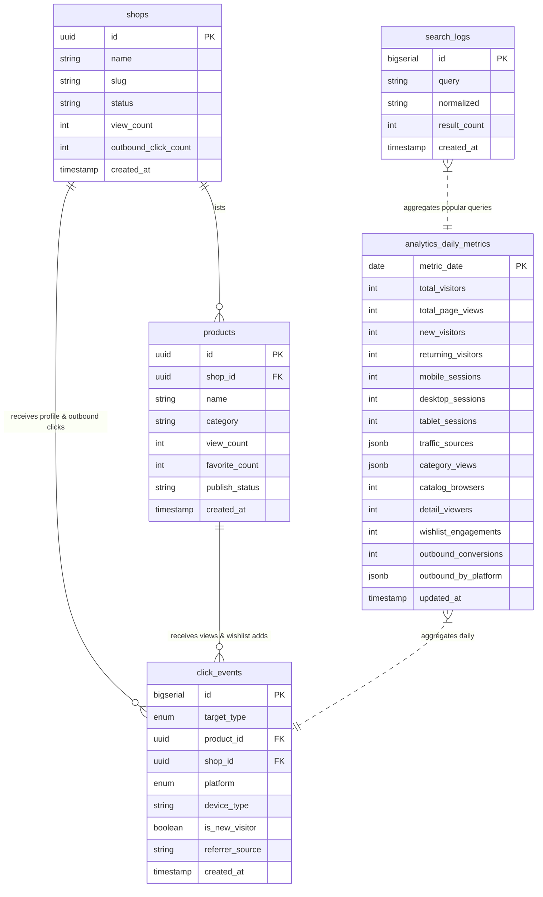

# Data Model Specification: Admin Performance & Conversion Dashboard

**Feature**: `001-admin-performance-dashboard`  
**Date**: 2026-11-11  
**Status**: Ready  

---

## 1. Entity Relationship Overview

---

## 2. Entity Definitions

### 2.1 `analytics_daily_metrics` (Daily Aggregation Rollup)
Stores daily pre-aggregated figures for high-speed dashboard reads.

| Field Name | Type | Constraints | Description |
| :--- | :--- | :--- | :--- |
| `metric_date` | `DATE` | `PRIMARY KEY` | The date of the metric record (UTC / VN local date) |
| `total_visitors` | `INTEGER` | `NOT NULL, DEFAULT 0, >= 0` | Total distinct estimated visitor sessions |
| `total_page_views` | `INTEGER` | `NOT NULL, DEFAULT 0, >= 0` | Total route views recorded across the platform |
| `new_visitors` | `INTEGER` | `NOT NULL, DEFAULT 0, >= 0` | Visitors arriving without a prior visit flag |
| `returning_visitors`| `INTEGER` | `NOT NULL, DEFAULT 0, >= 0` | Visitors arriving with prior visit flag present |
| `mobile_sessions` | `INTEGER` | `NOT NULL, DEFAULT 0, >= 0` | Sessions originating from mobile devices |
| `desktop_sessions`| `INTEGER` | `NOT NULL, DEFAULT 0, >= 0` | Sessions originating from desktop computers |
| `tablet_sessions` | `INTEGER` | `NOT NULL, DEFAULT 0, >= 0` | Sessions originating from tablet devices |
| `traffic_sources` | `JSONB` | `NOT NULL, DEFAULT '{}'` | Key-value distribution (`organic`, `social`, `direct`, `referral`, `other`) |
| `category_views` | `JSONB` | `NOT NULL, DEFAULT '{}'` | Aggregated view counts keyed by category name |
| `catalog_browsers` | `INTEGER` | `NOT NULL, DEFAULT 0, >= 0` | Funnel Stage 2: Users browsing `/products` or `/stores` |
| `detail_viewers` | `INTEGER` | `NOT NULL, DEFAULT 0, >= 0` | Funnel Stage 3: Users viewing product or shop details |
| `wishlist_engagements` | `INTEGER` | `NOT NULL, DEFAULT 0, >= 0` | Funnel Stage 4: Users adding products to favorites |
| `outbound_conversions` | `INTEGER` | `NOT NULL, DEFAULT 0, >= 0` | Funnel Stage 5: Users clicking shop outbound links |
| `outbound_by_platform` | `JSONB` | `NOT NULL, DEFAULT '{}'` | Outbound counts keyed by platform (`shopee`, `instagram`, `zalo`, `tiktok`, `website`) |
| `updated_at` | `TIMESTAMPTZ`| `NOT NULL, DEFAULT NOW()` | Last update timestamp |

### 2.2 `click_events` (Raw Event Ledger - SRS §8)
An append-only anonymous event log for auditing and granular drill-downs.

| Field Name | Type | Constraints | Description |
| :--- | :--- | :--- | :--- |
| `id` | `BIGSERIAL` | `PRIMARY KEY` | Incremental event ID |
| `target_type` | `ENUM` | `NOT NULL` | `'product_view'`, `'shop_view'`, `'wishlist_add'`, `'wishlist_remove'`, `'social_link'`, `'order_now'` |
| `product_id` | `UUID` | `NULLABLE, FK -> products(id)` | Associated product if event relates to a product |
| `shop_id` | `UUID` | `NULLABLE, FK -> shops(id)` | Associated shop if event relates to a shop or shop outbound |
| `platform` | `ENUM` | `NULLABLE` | `'instagram'`, `'tiktok'`, `'facebook'`, `'threads'`, `'shopee'`, `'website'`, `'zalo'` |
| `device_type` | `VARCHAR(16)` | `NOT NULL, DEFAULT 'mobile'` | `'mobile'`, `'desktop'`, `'tablet'` |
| `is_new_visitor` | `BOOLEAN` | `NOT NULL, DEFAULT false` | Indicates if client flagged session as first visit |
| `referrer_source`| `VARCHAR(32)`| `NOT NULL, DEFAULT 'direct'`| `'organic'`, `'social'`, `'direct'`, `'referral'`, `'other'` |
| `created_at` | `TIMESTAMPTZ`| `NOT NULL, DEFAULT NOW()` | Event capture timestamp |

### 2.3 Incremental Fields on Existing Tables
To support instantaneous sorting of Top 10 leaderboards without running expensive table joins:

#### On table `products`:
- `view_count`: `INTEGER NOT NULL DEFAULT 0 CHECK (view_count >= 0)`
- `favorite_count`: `INTEGER NOT NULL DEFAULT 0 CHECK (favorite_count >= 0)`

#### On table `shops`:
- `view_count`: `INTEGER NOT NULL DEFAULT 0 CHECK (view_count >= 0)`
- `outbound_click_count`: `INTEGER NOT NULL DEFAULT 0 CHECK (outbound_click_count >= 0)`

---

## 3. Data Validation & Business Rules

1. **Non-Negative Invariant**: Counter increments are atomic, and decrements must never drop below 0:
   $$\text{favorite\_count} = \max(0, \text{favorite\_count} + \Delta)$$
2. **Funnel Monotonic Consistency**: In any calculated conversion funnel snapshot:
   $$\text{Stage}_{i} \le \text{Stage}_{i-1}$$
   If an unexpected anomaly occurs (e.g. tracking interruption), the dashboard displays raw stage totals with transparent stage-to-stage transition indicators.
3. **Data Anonymization**: No IP address, cookie identifier, or user authentication ID shall ever be written to `analytics_daily_metrics` or `click_events`.
4. **Shop Terminology Validation**: Every entity referencing an artisan, designer, or seller MUST be named `shop` or `shop_id`. Use of "xưởng" is prohibited in all schemas and constraints.
