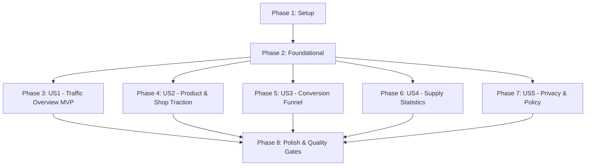

# Tasks: Admin Performance & Conversion Dashboard

**Input**: Design documents from `specs/001-admin-performance-dashboard/`  
**Prerequisites**: `plan.md`, `spec.md`, `research.md`, `data-model.md`, `contracts/analytics-api.yaml`, `quickstart.md`  
**Organization**: Tasks are grouped by user story to enable independent implementation and testing of each story.

---

## Phase 1: Setup (Shared Infrastructure)

**Purpose**: Initialize data schemas, contracts, client helper, and serverless endpoint skeleton.

- [X] T001 Define analytics and dashboard data interfaces and contract types in `src/types.ts`
- [X] T002 [P] Create database migration `supabase/migrations/00021_analytics_daily_rollups.sql` with table `analytics_daily_metrics`, atomic counter columns on `products` (`view_count`, `favorite_count`), and atomic counter columns on `shops` (`view_count`, `outbound_click_count`)
- [X] T003 [P] Create client analytics tracking utility in `src/lib/analytics.ts` using `navigator.sendBeacon` and `keepalive: true`
- [X] T004 Create consolidated serverless router skeleton in `api/analytics.ts` supporting `POST` (track) and `GET` (overview/funnel) actions

---

## Phase 2: Foundational (Blocking Prerequisites)

**Purpose**: Core infrastructure that MUST be complete before ANY user story can be implemented.

- [X] T005 Implement Admin authentication and authorization guard in `api/analytics.ts` using `api/_lib/supabaseAuth.ts`
- [X] T006 Implement event ingestion pipeline for `POST /api/analytics?action=track` in `api/analytics.ts` handling `page_view`, `product_view`, `shop_view`, `wishlist_toggle`, `outbound_click`, and `search_query`
- [X] T007 [P] Implement Upstash Redis caching layer helper in `api/analytics.ts` (5-minute TTL cache for dashboard queries)
- [X] T008 [P] Implement client-side `ti_visited_before` local storage check in `src/lib/analytics.ts` to distinguish new vs. returning visitors without IP or cookies
- [X] T009 Add automated route-change pageview tracking hook in `src/App.tsx` or `src/lib/analytics.ts`

**Checkpoint**: Core ingestion and admin endpoint ready. User story implementation can now begin.

---

## Phase 3: User Story 1 - Macro Website Traffic & Audience Growth (Priority: P1) 🎯 MVP

**Goal**: Deliver macro website traffic overview (Total Visitors, Total Page Views, New vs Returning ratio, Device distribution, Acquisition channels, and daily trendline chart).

**Independent Test**: Simulate anonymous visits from mobile and desktop, then open Admin Hub in `/portal` to verify KPI cards, donut charts, and line chart match aggregated records.

- [X] T010 [P] [US1] Implement backend date-window aggregation query for visitors, page views, new/returning counts, devices, and traffic sources in `api/analytics.ts`
- [X] T011 [P] [US1] Create summary KPI card component and time-series line chart in `src/components/admin/AnalyticsDashboard.tsx`
- [X] T012 [P] [US1] Create Device breakdown and Traffic acquisition donut charts in `src/components/admin/AnalyticsDashboard.tsx`
- [X] T013 [US1] Add interactive date range selector (Today, 7D, 30D, Month, Custom) with comparison delta calculation in `src/components/admin/AnalyticsDashboard.tsx`
- [X] T014 [US1] Mount `AnalyticsDashboard` under the "Tổng quan" tab in `src/views/Portal.tsx`

**Checkpoint**: At this point, User Story 1 is a viable MVP delivering complete traffic monitoring.

---

## Phase 4: User Story 2 - Product Discovery & Shop Promotion Effectiveness (Priority: P1)

**Goal**: Measure promotion effectiveness with Top 10 Viewed Products, Top 10 Favorited Products, Top 10 Clicked Shops, Category distribution, and Search keyword frequencies.

**Independent Test**: View products, favorite items, click shops, and execute search queries; verify that the leaderboards and category shares accurately rank items.

- [X] T015 [P] [US2] Implement leaderboard query in `api/analytics.ts` for Top 10 Viewed Products, Top 10 Favorited Products, Top 10 Clicked Shops, Popular Categories, and Search Keywords
- [X] T016 [P] [US2] Create Top 10 leaderboard tables (Products viewed, Products favorited, Shops clicked) in `src/components/admin/AnalyticsDashboard.tsx`
- [X] T017 [P] [US2] Create Category interest distribution progress bars and Top Search Keywords list in `src/components/admin/AnalyticsDashboard.tsx`
- [X] T018 [US2] Dispatch `product_view` tracking beacon on mount in `src/views/ProductDetail.tsx`
- [X] T019 [US2] Dispatch `shop_view` tracking beacon on mount in `src/views/ShopDisplay.tsx`
- [X] T020 [US2] Dispatch `search_query` tracking beacon when users submit catalog searches in `src/views/Products.tsx`

**Checkpoint**: User Stories 1 AND 2 are functional, giving full visibility into audience and product/shop traction.

---

## Phase 5: User Story 3 - Full-Funnel Conversion Rate Measurement (Priority: P1)

**Goal**: Track and visualize the 5-stage conversion funnel (Visit -> Catalog -> Detail View -> Wishlist -> Outbound Conversion to Shop) and outbound channel breakdown.

**Independent Test**: Complete a full user journey from landing to clicking an outbound shop link (Instagram/Shopee/Zalo); verify all 5 funnel bars and conversion percentages calculate accurately.

- [X] T021 [P] [US3] Implement 5-stage conversion funnel calculation and outbound platform breakdown in `api/analytics.ts`
- [X] T022 [P] [US3] Create horizontal conversion funnel visualization component with step drop-off percentages and overall conversion rate in `src/components/admin/AnalyticsDashboard.tsx`
- [X] T023 [P] [US3] Create outbound channel referral breakdown card (Shopee, Instagram, Zalo, TikTok, Website) in `src/components/admin/AnalyticsDashboard.tsx`
- [X] T024 [US3] Dispatch `outbound_click` tracking beacon when user clicks contact/purchase links in `src/views/ProductDetail.tsx`
- [X] T025 [US3] Dispatch `outbound_click` tracking beacon when user clicks social/store links in `src/views/ShopDisplay.tsx`

**Checkpoint**: The 5-stage conversion funnel accurately proves promotional ROI for participating shops.

---

## Phase 6: User Story 4 - Shop Directory & Product Catalog Growth Statistics (Priority: P2)

**Goal**: Monitor platform supply growth including total registered shops (approved active vs. pending review), total listed products, and new products added in timeframe.

**Independent Test**: Create or approve shops and products in a test window; verify the supply KPI cards reflect updated totals and pending counts.

- [X] T026 [P] [US4] Implement database query in `api/analytics.ts` calculating active shops, pending review shops, total listed products, and new products added within the selected date window
- [X] T027 [US4] Add supply metric indicators (Approved Shops, Pending Applications, Listed Products, New Additions) into the overview KPI cards in `src/components/admin/AnalyticsDashboard.tsx`

**Checkpoint**: Admin has real-time visibility into both consumer demand and platform supply expansion.

---

## Phase 7: User Story 5 - Privacy-Preserving Analytics & Policy Synchronization (Priority: P2)

**Goal**: Guarantee zero IP or PII tracking, implement atomic favorite counter pings, and synchronize public Privacy Policy documentation.

**Independent Test**: Inspect network payloads to verify no IP or user ID is sent; toggle favorites and verify atomic increment/decrement; verify Privacy Policy text.

- [X] T028 [P] [US5] Implement atomic increment/decrement handler in `api/analytics.ts` ensuring `favorite_count` on products never drops below 0
- [X] T029 [US5] Wire favorite toggle dispatch `trackFavoriteDelta(productId, delta)` in `src/views/ProductDetail.tsx` and `src/components/ProductCard.tsx`
- [X] T030 [P] [US5] Update Privacy Policy in `Policy.md` to document anonymous browser visit markers and aggregate favorite counters
- [X] T031 [P] [US5] Update terms and privacy notices in `src/views/Terms.tsx` to align with updated policy documentation

**Checkpoint**: Privacy-first compliance verified and documentation fully aligned.

---

## Phase 8: Polish & Cross-Cutting Concerns

**Purpose**: Verification gates, lint compliance, and documentation.

- [X] T032 [P] Run strict TypeScript typecheck gate (`npm run lint` / `tsc --noEmit`) and fix any compiler warnings
- [X] T033 [P] Verify Vercel Serverless Function file limit (confirm total files in `api/` does not exceed 12)
- [X] T034 [P] Verify ubiquitous domain terminology (execute `git grep -i "xưởng"` to confirm zero occurrences; enforce "shop")
- [X] T035 [P] Verify navigation constraints (confirm `/about` link remains strictly hidden from public navigation)
- [X] T036 Execute manual quickstart verification scenarios from `quickstart.md`
- [X] T037 Update `devlog/2026-11-11.md` with implementation summary, test results, and retrospectives

---

## Dependencies & Execution Order

### Phase Dependencies

- **Phase 1 (Setup)**: Completed.
- **Phase 2 (Foundational)**: Completed.
- **Phases 3-7 (User Stories)**: Completed.
- **Phase 8 (Polish)**: Completed.

---

## Implementation Strategy & MVP Scope

1. **Step 1 (MVP)**:
   - Complete Phase 1 (Setup: T001-T004) + Phase 2 (Foundational: T005-T009).
   - Complete Phase 3 (US1: T010-T014).
   - **Validate MVP**: Admin logs in, views traffic overview, daily trendlines, devices, and sources.
2. **Step 2 (Promotion Traction & Funnel)**:
   - Complete Phase 4 (US2: T015-T020) + Phase 5 (US3: T021-T025).
   - **Validate Funnel**: Admin analyzes top products/shops and the 5-stage conversion rate.
3. **Step 3 (Catalog Growth & Privacy)**:
   - Complete Phase 6 (US4: T026-T027) + Phase 7 (US5: T028-T031).
   - Complete Phase 8 (Polish & Gates: T032-T037).
